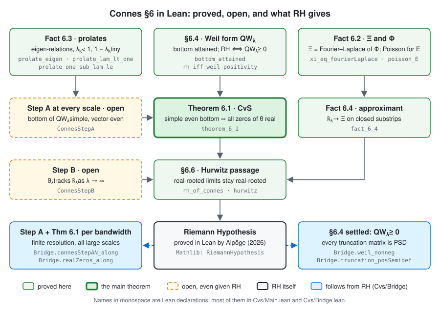
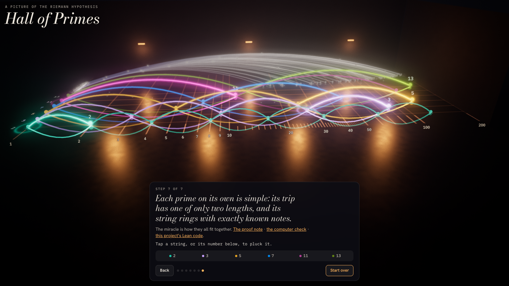

# cvs-lean — Connes' §6 in Lean

A standalone Lean 4 + Mathlib formalisation of the programme in §6 of
A. Connes, [*The Riemann Hypothesis: past, present and a letter through time*](https://arxiv.org/abs/2602.04022)
(arXiv:2602.04022, 2026). It is built around **Theorem 6.1** of A. Connes and W. D. van Suijlekom,
[*Quadratic Forms, Real Zeros and Echoes of the Spectral Action*](https://arxiv.org/abs/2511.23257)
(arXiv:2511.23257, 2025). If the bottom of a truncated Weil-type quadratic form is simple with an even
eigenvector, the Fourier transform of that eigenvector has only real zeros.

<p align="center">
  <a href="docs/figures/section6.svg"></a>
</p>

The project proves that theorem in its finite and continuous forms. It also formalises Facts 6.2–6.4,
the Weil form `QW_λ` of §6.4, and the assembly of §6.6. In addition it contains a body of further
results on the open steps: prolate analysis, the L2a positivity programme, step (a) criteria, and
RH routes through Connes' vector. A bridge file states what a proof of the Riemann Hypothesis gives
this programme.

* Lean `v4.36.0`, Mathlib `v4.36.0`; no other dependencies.
* About 2 296 modules, 465 000 lines and 40 150 theorems.
* Every theorem uses only the standard axioms `propext`, `Classical.choice` and `Quot.sound`.
  There are no `sorry`s and no extra axioms; see [Checking](#checking).

## The Hall of Primes

[](https://j-white.github.io/cvs-lean/)

[**The Hall of Primes**](https://j-white.github.io/cvs-lean/) is an interactive WebGL picture of the
Riemann Hypothesis for readers with no mathematical background. Primes walk a slide-rule hallway,
springs for the zeta zeros push its floor, and the explicit formula balances the two. It is told in
seven steps, and every number it shows is computed from the Weil form formalised here.
[`agents/SCENE.md`](agents/SCENE.md) describes the scene and maps each visual to its Lean theorem.

The page is the single file [`docs/index.html`](docs/index.html). To run it locally:

```sh
python3 -m http.server -d docs 8000   # then open http://localhost:8000
```

Each push to `main` that touches `docs/` publishes it to GitHub Pages through
[`.github/workflows/pages.yml`](.github/workflows/pages.yml).

## Start here

* [`Cvs/Main.lean`](Cvs/Main.lean) restates the headline results in the order of Connes §6. Each
  entry is a one-line `alias`, so following the name leads to the proof.
* [`Cvs/Bridge.lean`](Cvs/Bridge.lean) takes `hRH : RiemannHypothesis` (Mathlib's statement) as a
  hypothesis and derives the consequences for Connes' programme.

## Connes §6, item by item

| Connes | Lean (`Cvs.…`) | module |
|---|---|---|
| Thm 6.1, finite matrices: real spectrum of the rank-one perturbation | `finite_real_spectrum` | `Finite.EigenvectorFormRealSpectrum` |
| Thm 6.1, finite: real secular roots | `finite_secular_roots_real` | `Finite.SecularRootsReal` |
| Thm 6.1, even sector only (no odd-sector condition) | `even_sector_secular` | `Finite.EvenBottomRealRoots` |
| Thm 6.1 for every truncation, no hypotheses | `exists_zeroFree_even_ground` | `Limit.SpineWithoutSimplicity` |
| **Thm 6.1 for `QW_λ`**: under Step A every zero of `θ̂` is real | `theorem_6_1`, `ConnesStepA` | `TheoremSixOne.MinimiserTransformRealZeros` |
| Thm 6.1 at `λ = √2`, unconditional | `theorem_6_1_at_sqrt_two` | `Composition.ConnesSectionSix` |
| Hurwitz, and RH from limits | `hurwitz`, `rh_of_Xi_ne_zero`, `rh_of_limit` | `Upstream.Hurwitz`, `Limit.*` |
| Fact 6.2: Ξ as Fourier–Laplace of Φ, Φ even, Poisson (18) for `E` | `xi_eq_fourierLaplace`, `riemannPhi_even`, `poisson_E` | `Xi.*` |
| Fact 6.3: prolate eigen-relations, sinc kernel, `λ_k < 1`, `1 − λ_k` exponentially small | `prolate_eigen`, `prolate_sinc_eigen`, `prolate_lam_lt_one`, `prolate_one_sub_lam_le` | `Prolate.*` |
| Step A for the prolate operator (the analogue Connes cites in §6.6) | `prolate_stepA` | `StepA.ProlateOperatorStepA` |
| §6.4: bottom of `QW_λ` attained; the trigonometric matrix is the Weil form | `bottom_attained`, `weil_matrix` | `WeilForm.BottomAttained`, `Finite.TruncationQuadraticForm` |
| §6.4: RH ⟺ Weil positivity of `QW_λ` (exact and approximate forms, PSD form) | `rh_iff_weil_positivity`, `rh_iff_approx_weil_positivity`, `rh_iff_posSemidef` | `WeilForm.*` |
| §6.4 on smooth window tests `𝓓((0, log x), ℝ)`: `d/du` is skew and `1/4 − d²/du²` self-adjoint for the Weil form, unconditionally; RH ⟺ positivity there ⟺ Parseval for the zero samples | `weil_deriv_skew`, `weil_operator_selfAdjoint`, `rh_iff_window_test_positivity`, `rh_iff_zero_sample_parseval` | `WeilForm.WindowTestSelfAdjoint`, `WeilForm.WindowTestWeilCriterion` |
| **Fact 6.4**: `k̂_λ → Ξ` uniformly on closed substrips, with an explicit error | `fact_6_4`, `fact_6_4_error` | `Approximant.FactSixFour` |
| §6.6: Step A for `QW_λ` gives Step A for all fine truncations | `stepA_finite_of_stepA` | `StepA.ConnesStepAModeCount` |
| §6.6, ingredients of Step A: the odd ground state is simple, a minimiser has definite parity, Step A holds on the circle's even modes, the even bottom from a depth bound on the zeros | `odd_ground_state_simple`, `minimiser_even_of_lt`, `stepA_circle_even`, `even_bottom_of_zero_depth` | `StepA.OddGroundStateSimple`, `StepA.MinimiserDefiniteParity`, `StepA.CircleEvenModesSimpleIsolated`, `StepA.EvenBottomZeroDepth` |
| §6.6: RH ⟺ the even bulk floor at loss `x^ε` along any infinite set of scales | `rh_iff_floor_along_scales` | `Route.TerminalFloorAlongScales` |
| **§6.6 assembled**: Step A at every scale + Fact 6.4 + Step B ⇒ RH | `rh_of_connes` | `Composition.ConnesSectionSix` |
| §6.6: RH ⟺ step (a) along every fixed bandwidth ∧ `DepthToZero`, unconditional | `rh_iff_stepA_along_bandwidths` | `StepA.StepAAlongEveryBandwidth` |

What is **not** formalised from §6:
* Theorem 6.1 for an arbitrary real distribution `D`. It is proved for the Weil distribution, which
  is the case §6 uses.
* The operator `A_λ` itself. Everything is stated at the level of the closed quadratic form. The
  nearest result is that `1/4 − d²/du²` is self-adjoint for the Weil form on smooth window tests
  (`weil_operator_selfAdjoint`); `A_λ` is not constructed.
* The asymptotics of `ε(λ)`, which are numerical in the paper.

The two hypotheses of `rh_of_connes`, Step A at every scale and Step B, are the open steps of §6.6.
They are hypotheses here, not theorems.

## Layout

| directory | contents |
|---|---|
| `Cvs/Upstream` | general lemmas in Mathlib style: Hurwitz, Hilbert's inequality, Montgomery–Vaughan, Schur floors, Hardy spaces, … |
| `Cvs/PNT` | files ported from PrimeNumberTheoremAnd (Apache 2.0, attribution in each header) |
| `Cvs/Zeta` | ζ, Γ and digamma, ξ, zero counting, Riemann–von Mangoldt, explicit formula, Hadamard product, convexity, Gaussian kernels |
| `Cvs/Xi` | §6.2: Ξ, Riemann's Φ, theta, the summation map `E`, Poisson duality |
| `Cvs/Finite` | §6.1(i): divided-difference matrices, displacement identity, secular equation, truncation matrices |
| `Cvs/Limit` | §6.1(ii): Hurwitz passages and limit criteria |
| `Cvs/WeilForm` | §6.4: the Weil form on the window, its archimedean and prime sides, form domain, compactness, positivity ⟺ RH |
| `Cvs/TheoremSixOne` | Theorem 6.1 for `QW_λ` |
| `Cvs/Prolate` | §6.3: prolate rungs, eigenvalues, envelopes, Liouville–Green and Olver bounds, Mellin laws, cell Grams, Hardy extension |
| `Cvs/L2a` | positivity of the Weil form on prolate tails and rung spans |
| `Cvs/Approximant` | §6.5: `k_λ`, Connes' vector, the spine and Hermite profiles, Fact 6.4 |
| `Cvs/StepA` | §6.6: odd sector, step (a), quartets, edge and top sets, bandwidth criteria |
| `Cvs/Route` | RH routes on the above: joint gap, angle bound, graded floor on Connes' hyperplane, visibility |
| `Cvs/Composition` | Connes' §6 assembled |
| `Cvs/PathLaw` | the path law: norm and spectrum of a single atom (a masked rotation), the odd sector, the triangle-inequality budget for several atoms, the two-atom bound and its attainment, infinite rank of the atom |

## The bridge to a proof of RH

`Cvs/Bridge.lean` uses only the statement `RiemannHypothesis` from
`Mathlib/NumberTheory/LSeries/RiemannZeta.lean`. Any Lean proof of that statement, by any route,
instantiates the file without being imported into this project.
L. Alpöge's Lean proof (2026) is such a proof. It proves Mathlib's `RiemannHypothesis` from the
standard axioms, so the consequences below hold unconditionally. It is too large to vendor, so it is
not imported here. Given `hRH`:

* `Cvs.Bridge.weil_nonneg`: `QW_λ ≥ 0` on its form domain at every scale (§6.4).
* `Cvs.Bridge.truncation_posSemidef`: every finite truncation matrix is positive semidefinite.
* `Cvs.Bridge.connesStepAN_along`: along every fixed bandwidth `Ω > 0`, at all large integer scales,
  the bottom of the truncated Weil matrix is simple with an even eigenvector. This is Connes' Step A
  of §6.6 at finite resolution.
* `Cvs.Bridge.realZeros_along`: for those truncations the even bottom eigenvector's transform has no
  zero off the real axis. This is Theorem 6.1's conclusion at finite resolution.
* `Cvs.Bridge.depthToZero`: every band off the critical line holds finitely many zeros.

These consequences characterise RH. `Cvs.Bridge.riemannHypothesis_iff` and
`Cvs.Bridge.riemannHypothesis_iff_weil` are equivalences. The bridge does not yield the continuous
Step A (`ConnesStepA` at every scale) or Step B, and the file says so.

## The path-law paper

`paper/pathlaw.tex` is a standalone paper on the path law formalised in `Cvs/PathLaw`; the built copy
is [`paper/build/pathlaw.pdf`](paper/build/pathlaw.pdf). `make -C paper` rebuilds it with tectonic.
`make -C paper numerics` reruns the scripts in `paper/numerics/`, which need Python 3.12 or later with
numpy and mpmath and reproduce every number the paper quotes.

## Building

```sh
lake exe cache get   # Mathlib oleans
lake build
```

## Checking

```sh
lake env lean Audit.lean      # #print axioms for every headline theorem in Main and Bridge
lake env lean AuditAll.lean   # every theorem of the project (about 2.5 minutes)
```

`Audit.lean` lists exactly `[propext, Classical.choice, Quot.sound]` for each headline theorem.
`AuditAll.lean` reports `theorems checked: 40153, with non-standard axioms: 0`.

The figure at the top is generated by [`docs/figures/section6.py`](docs/figures/section6.py) from
the Lean declaration names. The script fails if a name is missing from the source, and in the SVG
each box links to its theorem.

## References

* A. Connes, *The Riemann Hypothesis: past, present and a letter through time*,
  [arXiv:2602.04022](https://arxiv.org/abs/2602.04022) ([PDF](https://arxiv.org/pdf/2602.04022)).
  §6 is the programme formalised here. Published in the Journal of Open Mathematical Problems 2(1) (2026).
* A. Connes, W. D. van Suijlekom, *Quadratic Forms, Real Zeros and Echoes of the Spectral Action*,
  [arXiv:2511.23257](https://arxiv.org/abs/2511.23257) ([PDF](https://arxiv.org/pdf/2511.23257)).
  This is the source of Theorem 6.1 and its finite truncations.
* A. Connes, C. Consani, H. Moscovici, *Zeta zeros and prolate wave operators*,
  [arXiv:2310.18423](https://arxiv.org/abs/2310.18423). Prolate operators and the spectral realisation
  behind Fact 6.3.
* A. Connes, C. Consani, *Weil positivity and trace formula, the archimedean place*,
  [arXiv:2006.13771](https://arxiv.org/abs/2006.13771). Weil positivity, which underlies §6.4.
* A. Connes, C. Consani, H. Moscovici, *Zeta Spectral Triples*,
  [arXiv:2511.22755](https://arxiv.org/abs/2511.22755). A follow-up with numerical convergence of the
  truncated spectra to the zeros.

## License

Apache 2.0 (see `LICENSE`). Files under `Cvs/PNT` come from PrimeNumberTheoremAnd under Apache 2.0
and keep their original headers.
